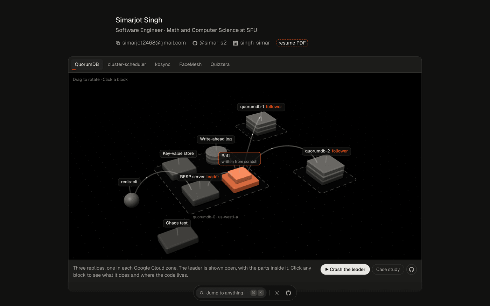
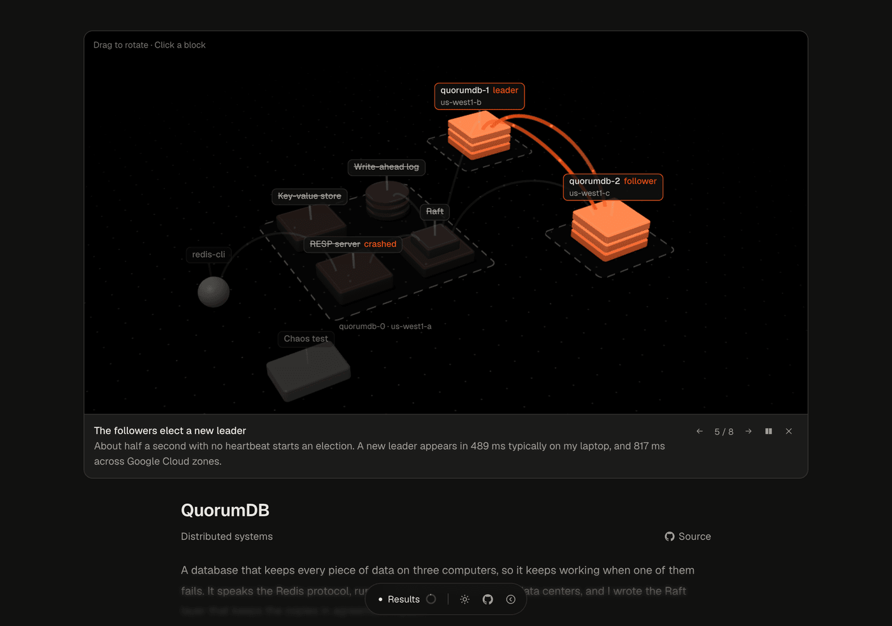
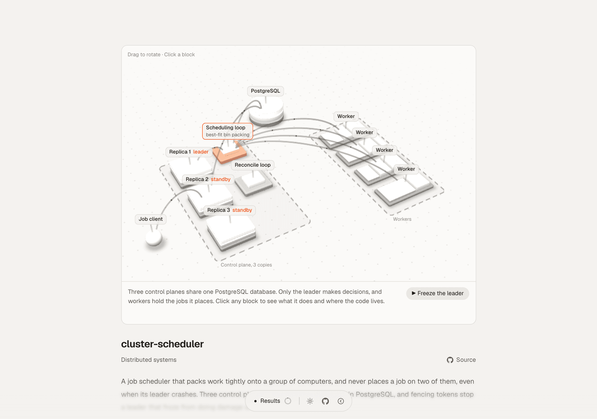
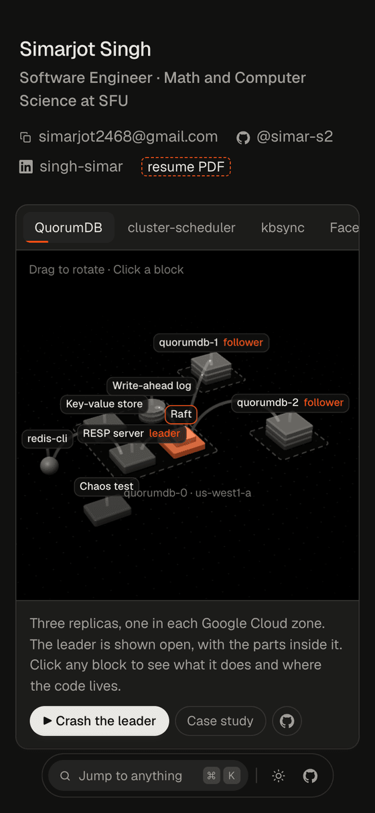
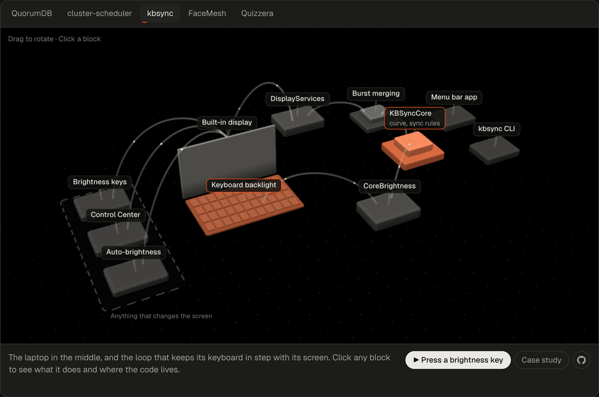
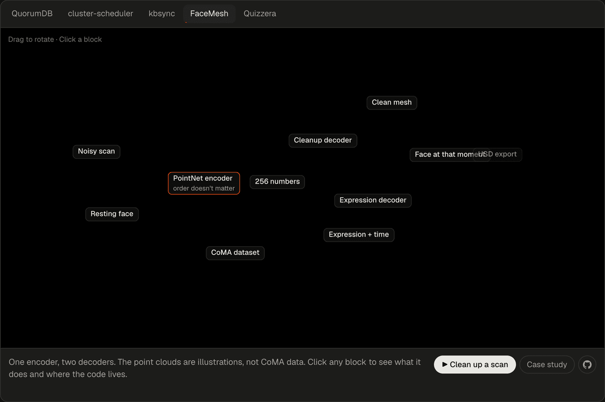
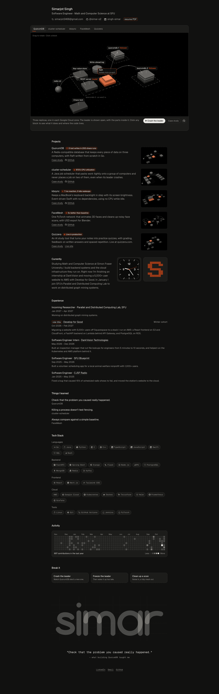

<div align="center">


# personal-portfolio

**My personal site. Five projects, each with a 3D render of its architecture that you can drag, click and break.**

[](https://simarsingh.dev)
[](astro.config.mjs)
[](src/render)
[](src/render)
[](LICENSE)

<br>



</div>

## ✨ What it does

- **Opens on the architecture.** The home page starts with a large live 3D render that moves through all five projects by itself, until you touch it.
- **Lets you explore it.** Drag to rotate. Click a block to see what it does and jump to the file on GitHub.
- **Lets you break things.** Crash QuorumDB's leader, freeze the scheduler's leader, or follow a noisy scan through FaceMesh, one step at a time.
- **Gives each project a case study,** with results, the decisions I made and what I learned, plus links to the code.
- **Loads fast.** A still image shows right away, then the small renderer takes over.

## 📸 Pictures

A walkthrough in progress: the leader has crashed and the other two have elected a new one.



| cluster-scheduler, in light mode | On a phone |
|---|---|
|  |  |

| kbsync | FaceMesh |
|---|---|
|  |  |

The whole home page:



## 🔬 How it works

It's a static site built with Astro, so pages are plain HTML with very little JavaScript.

The renders don't use three.js. I wrote a small WebGL2 renderer, because a 3D library would have been about 12x the size for scenes this simple.

- **One mesh.** Every block is the same rounded box, drawn with instancing. Change its corner radius and it becomes a slab, a cylinder or a sphere.
- **Six draw calls a frame:** ground, zones, shadows, blocks, wires and packets. Wires and packets are curves evaluated in the vertex shader, so moving them costs no CPU.
- **Real text.** Labels are DOM elements placed over the canvas, so they stay sharp and can be focused with a keyboard.
- **Switching projects is cheap.** Shaders stay compiled and only the scene data changes, so moving between tabs doesn't stall.
- **It backs off.** It stops when it's off screen or the tab is hidden, never goes above about 60 fps, and lowers its resolution if a GPU can't keep up. A still image shows first, and stays if WebGL isn't available.

A scene is plain data in [`src/scenes`](src/scenes): blocks, wires and walkthrough steps.

## 📊 Results

| | Result |
|---|---|
| Lighthouse: performance | **99** on the home and FaceMesh pages, **100** on QuorumDB |
| Lighthouse: accessibility, best practices, SEO | **100** on all three pages |
| Home page download | 168 KiB, with 1.6 s to the largest paint |
| Renderer script | **11 KB** gzipped |
| three.js, bundled for the same features | 134 KB gzipped |
| Slowest frame, across the scenes I measured | about **20 ms**, with 0 frames over 25 ms |
| Slowest frame while switching tabs | **18 ms** |
| FaceMesh with the CPU slowed 4x | 18 ms, with 0 frames over 25 ms |

Frames were measured on a MacBook Pro (M1 Pro, Metal) at retina resolution. Lighthouse ran against the live site with its default mobile settings.

## ⚡️ Run it

```bash
npm install
npm run dev        # http://localhost:4321/
```

To change the site:

| What | Where |
|---|---|
| My details, experience, tech stack | [`src/data/site.ts`](src/data/site.ts) |
| Case study text | [`src/content/projects`](src/content/projects) |
| 3D scenes and walkthroughs | [`src/scenes`](src/scenes) |

Anything in `[square brackets]` in `site.ts` or a case study shows up as a placeholder with a dashed outline.

After changing a scene, rebuild its still images:

```bash
npm run build && npm run preview   # in one terminal
npm run posters                    # in another
```

Pushing to `main` deploys to GitHub Pages. To use a custom domain, set `SITE_URL` and `BASE_PATH=/` in [the workflow](.github/workflows/deploy.yml).

## 📈 Analytics

Set `umamiWebsiteId` in [`site.ts`](src/data/site.ts) to turn on [Umami](https://umami.is), which uses no cookies and doesn't identify anyone. Until then, the script isn't loaded at all.

## 💡 Things I learned

- **Headless Chrome tests the wrong GPU.** By default it renders in software, so frame times mean nothing. Forcing it onto Metal gave real numbers.
- **Very tall screenshots wrap around.** My case study appeared to repeat its top section at the bottom of the page. The page was fine: the screenshot was taller than Chrome's 8,192-pixel texture limit.
- **Hidden wires still look like clutter.** Fading unused connections to 15% left a tangle on screen. Drawing them only when a step needs them made each scene readable.

## 🙏 Credits

The visual design follows [ashishgogula.in](https://www.ashishgogula.in) by Ashish Gogula, used with his permission. The projects-first structure and case study format were inspired by [anhdtrn.com](https://www.anhdtrn.com). All the code here is my own.

## 📄 License

[MIT](LICENSE)
